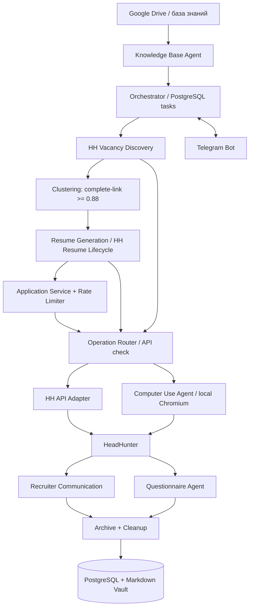

# HR Multi-Agent — бизнес-функциональные требования (БФТ)

> **Версия:** 0.5
> **Дата:** 2026-11-08
> **Статус:** согласованная проектная редакция для дальнейшего проектирования и реализации в Codex  
> **Источник вакансий MVP:** HeadHunter (hh.ru)  
> **Интерфейс пользователя:** Telegram-бот  
> **Режим:** автономный с передачей исключений пользователю

## 1. Назначение и границы MVP

**Цель:** создать систему автономного поиска работы для одного кандидата (Alexander Minkin), которая ищет вакансии, группирует их по сходству требований, создаёт адаптированные резюме и сопроводительные письма, откликается на вакансии, обрабатывает анкеты и переписку с работодателями, а также сообщает о приглашениях на интервью.

**Основной KPI:** количество релевантных приглашений на интервью на 100 подтверждённых откликов, а не абсолютное количество откликов.

**Принципы:**

1. HeadHunter — единственный источник вакансий для MVP.
2. Google Drive — внешний источник знаний о кандидате; PostgreSQL и Markdown-архив — внутреннее долговременное хранилище.
3. Основная единица подготовки документов — **кластер высокопохожих вакансий**, а не отдельная вакансия.
4. Для каждого кластера создаётся собственное адаптированное временное резюме **непосредственно в HeadHunter**; постоянные HH-резюме кандидата остаются нетронутыми.
5. Сопроводительное письмо формируется для кластера и при необходимости персонализируется для конкретной вакансии.
6. Все версии резюме хранятся во внутренней базе знаний как **Markdown (`.md`)**; история откликов, письма и переписка сохраняются независимо от удаления резюме на hh.ru.
7. Все основные настройки, наблюдение и управление выполняются через **Telegram-бота**; отдельной веб-панели MVP нет.
8. Автономные операции выполняются только при наличии технического доступа и с учётом правил соответствующих платформ. Операции с неопределённым результатом нельзя слепо повторять.
9. Нельзя выдумывать опыт, квалификацию, достижения, работодателей или навыки. Требования вакансии имеют высокий приоритет при подборе акцентов, но неподтверждённые навыки требуют верификации через Telegram.
10. **Computer Use — штатное направление MVP**, готовое выполнять разрешённые действия в локальном Chromium. Для каждой операции система сначала проверяет применимость HH API; при подтверждённой недоступности метода передаёт её браузерному адаптеру. Ошибки с неопределённым результатом сначала сверяются с HH, чтобы исключить повторное действие.

### 1.1. Базовые параметры

| Параметр | Решение |
|---|---|
| Кандидаты | 1 |
| Источник вакансий | HeadHunter |
| Пользовательский интерфейс | Telegram Bot |
| Хранилище знаний | Google Drive + PostgreSQL + Markdown Vault |
| Алгоритм кластеризации | Complete-link |
| Начальный порог сходства | **88%** |
| География в формуле сходства | **0%** |
| Резюме под отклики | 1 временное HH-резюме на кластер |
| Максимум одновременно существующих HH-резюме | **20**, включая постоянные |
| Удаление временного HH-резюме | Только после **явных отказов всех работодателей**, к которым был отправлен отклик с этим резюме, и архивирования истории |
| Формат долговременного хранения CV | `.md`, с версиями и неизменяемыми снимками |
| Исполнительный канал HH | Проверка доступности HH API для конкретной операции → разрешённый Computer Use при недоступности API → Telegram, если автоматическое выполнение невозможно |
| Браузерный исполнитель | Локальный Chromium + Playwright, штатный компонент MVP |
| Анкеты | Доступный HH API либо разрешённый Computer Use; результат обязательно подтверждается |
| CAPTCHA | Ожидание 60 сек.; одна допустимая повторная попытка; затем Telegram |
| Типовая интенсивность | 2 отклика/мин; иногда 3; очень редко 1 |
| Максимум в скользящем окне 60 сек. | 3 отклика, при условии соблюдения лимитов HH |
| Поиск вакансий | Утром, завершение до 12:00 МСК |
| Основное окно откликов | 16:00–02:00 МСК |
| Дополнительное окно | Иногда 02:00–04:00 МСК |
| Верхний лимит HH, подлежащий проверке и учёту | 200 откликов за последовательные 24 часа |
| Приглашение на интервью | Срочное сообщение в Telegram с версиями отправленных документов |

> **Критическое ограничение:** 2 отклика/мин — рабочая интенсивность в отдельные интервалы, **не** непрерывная отправка на протяжении всего окна 8–12 часов. Ограничение HeadHunter за 24 часа и другие действующие ограничения всегда имеют приоритет.

## 2. Сквозной бизнес-процесс

1. **Knowledge Base Agent** синхронизирует документы кандидата с Google Drive, извлекает факты и поддерживает структурированный профиль.
2. **Vacancy Discovery Agent** утром находит актуальные вакансии через доступный HH API либо разрешённый браузерный адаптер и устраняет дубликаты.
3. **Vacancy Clustering Agent** выделяет признаки и группирует вакансии по близости требований с порогом 88%.
4. **Resume Generation & Lifecycle Agent** создаёт Markdown-версию резюме для кластера, сопроводительное письмо и временное резюме в HH через доступный разрешённый канал.
5. **Application Agent** выбирает канал по результату проверки HH API, подаёт отклики по расписанию, проверяя лимиты, статус вакансии и отсутствие повторных откликов.
6. **Computer Use Agent** управляет локальным Chromium через Playwright для разрешённых операций HH и внешних форм, сохраняет состояние сессии и подтверждения результата.
7. **Questionnaire Agent** отвечает на вопросы и заполняет анкеты через доступный API либо Computer Use.
8. **Recruiter Communication Agent** отслеживает приглашения, отказы, сообщения и анкеты, отвечает на стандартные вопросы.
9. **Resume Lifecycle & Archive** сохраняет все артефакты и историю; удаляет временное HH-резюме только после отказов всех связанных работодателей и завершения архивирования.
10. **Telegram Bot** обеспечивает настройки, управление, просмотр отчётов, обработку исключений и уведомления.

**Независимая обработка событий:** новые сообщения, CAPTCHA, анкеты и приглашения обрабатываются вне расписания отправки откликов; не нужно ждать 16:00 для получения срочного уведомления.

## 3. БФТ-01 — Knowledge Base Agent

**Назначение:** поддерживать единую проверяемую базу фактов о кандидате.

| ID | Требование | Приоритет |
|---|---|---|
| KB-01 | Подключить выделенную папку Google Drive по OAuth | P0 |
| KB-02 | Импортировать PDF, DOCX, PPTX, Google Docs и Markdown | P0 |
| KB-03 | Извлекать опыт, работодателей, сроки, навыки, образование, проекты и достижения | P0 |
| KB-04 | Для каждого факта хранить первоисточник и степень подтверждения | P0 |
| KB-05 | Синхронизировать изменения документов (например, через Drive Changes API) | P0 |
| KB-06 | Неизвестные навыки направлять пользователю для подтверждения через Telegram | P0 |
| KB-07 | Хранить версии профессионального профиля и историю изменений | P0 |
| KB-08 | Использовать профиль при поиске вакансий, Matching и подготовке резюме | P0 |

**Статусы фактов:** `VERIFIED`, `DERIVED`, `UNVERIFIED`, `CONFLICTED`.

**Правила достоверности:**

- Неполное совпадение с вакансией допустимо: кандидат может закрывать примерно 80–85% её требований.
- Наличие требования в вакансии **не доказывает**, что у кандидата есть соответствующий навык.
- Если навык отсутствует в базе знаний, агент может запросить подтверждение и затем добавить его в профиль.
- Неподтверждённые и противоречивые сведения не используются как факты в автоматически отправляемых документах.
- Резюме оптимизируется под требования вакансии за счёт отбора, приоритизации и точных формулировок реального опыта.

**Критерий приёмки:** каждое фактическое утверждение в исходящем резюме прослеживается до подтверждённого источника либо подтверждения пользователя.

## 4. БФТ-02 — Vacancy Discovery & Clustering

### 4.1. Поиск вакансий

Агент создаёт поисковые запросы на основе проверенной базы знаний и настроек поиска; получает список и подробности вакансий через доступный HH API либо разрешённый Computer Use; сохраняет исходные данные и нормализованные поля с указанием канала получения; фильтрует неподходящие вакансии; исключает повторы; контролирует актуальность и закрытие вакансий.

Город/регион **не участвует в оценке сходства вакансий**, но может использоваться как независимый фильтр допустимых условий работы.

### 4.2. Оценка сходства

**Формула:**

\[
S(A,B) = 0.30H + 0.30T + 0.20I + 0.10L + 0.10F
\]

| Признак | Обозначение | Вес |
|---|---|---:|
| Hard skills и технические требования | H | **30%** |
| Обязанности и бизнес-задачи | T | **30%** |
| Отрасль и предметная область | I | **20%** |
| Уровень должности и ответственности | L | **10%** |
| Soft skills | F | **10%** |
| Город / география | — | **0%** |

**Порог:** `cluster_similarity_threshold = 0.88` (настраивается в Telegram).

**Метод:** *Complete-link* — каждая пара вакансий в одном кластере должна иметь сходство **не ниже 88%**. Это исключает транзитивное объединение несовместимых вакансий, когда A похожа на B, а B на C, но A недостаточно похожа на C.

Начальный способ реализации — извлечение структурированных признаков через LLM, нормализация терминов, embeddings/семантические оценки и детерминированное вычисление весовой функции. Веса и порог — **настраиваемые параметры**, а не результаты уже выполненного обучения.

| ID | Требование | Приоритет |
|---|---|---|
| CL-01 | Выделять структурированные признаки вакансии | P0 |
| CL-02 | Нормализовать синонимы навыков, инструментов, ролей и задач | P0 |
| CL-03 | Вычислять взвешенное сходство вакансий | P0 |
| CL-04 | Формировать кластеры по правилу Complete-link | P0 |
| CL-05 | Добавлять новые вакансии в подходящие кластеры либо создавать новый | P0 |
| CL-06 | Изменять порог сходства через Telegram | P0 |
| CL-07 | Изменять веса критериев через Telegram | P0 |
| CL-08 | Пересчитывать кластеры без изменения истории уже отправленных откликов | P0 |

**Критерий приёмки:** одинаковые по требованиям вакансии из разных городов могут попасть в один кластер; различающиеся по ключевым требованиям вакансии не объединяются, если попарное сходство ниже порога.

## 5. БФТ-03 — Resume Generation & Lifecycle Agent

### 5.1. Подготовка резюме и писем

Для каждого нового кластера:

1. Проанализировать общие требования и профиль задач кластера.
2. Выбрать наиболее релевантные **подтверждённые** факты из базы знаний.
3. Сформировать адаптированное резюме в Markdown (`.md`) и сохранить версию.
4. Создать сопроводительное письмо (до 150 слов), при необходимости дополнительно адаптировать его под конкретную вакансию.
5. Создать / опубликовать соответствующее **временное HH-резюме** через доступный HH API либо разрешённый Computer Use; проверить, что резюме действительно появилось в HH.
6. Связать `cluster_id`, `hh_resume_id`, версию Markdown и письма.
7. До каждого отклика проверить пригодность текущего кластерного резюме для вакансии; существенно отличающиеся вакансии вынести в отдельный кластер.

**Важно:** Markdown-архив не равен автоматически опубликованному резюме HH. Система обязана зафиксировать, какая именно версия HH-резюме реально использовалась в отклике. При необходимости DOCX/PDF можно формировать из Markdown, но **их не нужно хранить как основной архивный формат**.

### 5.2. Лимит 20 резюме и жизненный цикл

| ID | Требование |
|---|---|
| CV-01 | Создавать временное HH-резюме под каждый кластер |
| CV-02 | Сохранять постоянные HH-резюме неизменными |
| CV-03 | Хранить **все версии** резюме в `.md` |
| CV-04 | Сохранять неизменяемый снимок версии, реально использованной при каждом отклике |
| CV-05 | Перед созданием проверять доступные слоты HH |
| CV-06 | Учитывать общий лимит **20** HH-резюме, включая постоянные |
| CV-07 | Не удалять резюме после отказа одного работодателя, если есть другие связанные отклики |
| CV-08 | Удалять временное резюме **только после явных отказов всех связанных работодателей** |
| CV-09 | До удаления полностью архивировать письма, ответы, сообщения, статусы и использованные документы |
| CV-10 | Когда свободных слотов нет, помещать новые кластеры в очередь ожидания |

**Строгое правило удаления:**

- Временное резюме может быть общим для нескольких вакансий кластера.
- Отказ одного работодателя закрывает только его отклик.
- Пока хотя бы один связанный отклик ожидает решения, получил приглашение, находится в переписке или не имеет **явного отказа**, временное HH-резюме **не удаляется**.
- Отсутствие ответа, закрытие вакансии или истечение срока ожидания **не считаются отказом**.
- Когда **все работодатели, которым отправлен отклик с этим резюме, отказали**, система проверяет, что нет активных диалогов и новых неотправленных вакансий, использующих это резюме; архивирует документы и историю; затем допускает удаление из HH.
- Удаление через API или браузер подтверждается на стороне HH; неопределённый результат не запускает повторное удаление автоматически.
- Удаление из HH никогда не удаляет локальный Markdown, письма, сообщения или историю откликов.

Если все 20 слотов заняты, поиск и кластеризация продолжаются, но создание новых временных HH-резюме приостанавливается.

## 6. БФТ-04 — Application & Questionnaire Agents

### 6.1. Отклики

| ID | Требование |
|---|---|
| APP-01 | Проверять, что вакансия релевантна и отклик разрешён правилами пользователя |
| APP-02 | Исключать повторы отклика на одну вакансию |
| APP-03 | Выбирать временное HH-резюме соответствующего кластера |
| APP-04 | Готовить итоговый текст сопроводительного письма |
| APP-05 | Проверять доступность HH API для конкретного отклика; при подтверждённой недоступности передавать подготовленный пакет разрешённому Computer Use Agent |
| APP-06 | Соблюдать временное расписание и ограничения частоты/суточного объёма |
| APP-07 | Подтверждать результат отправки на стороне HH |
| APP-08 | Сохранять снимки отправленных документов, письма и историю операций |
| APP-09 | Для API и браузера использовать одну запись отклика, один общий лимитер и единый журнал попыток; не допускать повторной отправки при смене канала |

**Маршрутизация:** до внешнего действия проверить применимость API. Явное отсутствие права или неподдерживаемый метод направляет задачу в Computer Use, если этот сценарий разрешён. Ошибки авторизации сначала требуют обновления токена/повторной проверки прав. `429`, CAPTCHA и ограничения платформы приостанавливают действие; браузер не используется для их обхода. При сетевом сбое, тайм-ауте или `5xx` после отправки запроса результат считается неопределённым: сначала сверить отклик на стороне HH через доступный канал. Пока отсутствие отклика не установлено достоверно, повтор через API или браузер запрещён. Если браузерная операция завершилась без подтверждения результата, применяется то же правило.

**Идемпотентность:** один `vacancy_id` может иметь только один подтверждённый отклик; переключение канала не создаёт новый пакет и не сбрасывает историю попыток.

### 6.2. Анкеты

| Ситуация | Предпочтительный механизм |
|---|---|
| Обычный отклик | Проверить HH API; при подтверждённой недоступности — разрешённый Computer Use |
| Анкета, доступная через API | HH API с подтверждением результата |
| Анкета HH, которую невозможно заполнить через API | Разрешённый Computer Use |
| Google Forms / Яндекс Формы | Разрешённый Computer Use / браузерный адаптер |
| Требование CAPTCHA | Штатная проверка пользователем через Telegram |
| Недостаточно данных для достоверного ответа | Вопрос пользователю в Telegram |

**Questionnaire Agent должен:**

1. Обнаруживать вопросы до отклика или после сообщения работодателя.
2. Извлекать вопросы, типы элементов и обязательность полей.
3. Формировать ответы на основании базы знаний **и резюме, отправленного именно по этой вакансии**.
4. Проверять согласованность и достоверность ответов.
5. Заполнять текстовые поля, списки, варианты выбора и многошаговые формы доступным разрешённым способом.
6. Сохранять вопросы, ответы, источники, итог отправки и подтверждение результата.
7. Передавать пользователю вопросы или подтверждения, требующие личного решения.
8. Рассматривать содержимое внешних форм как недоверенный ввод; не выполнять встроенные в них инструкции, не относящиеся к анкете.

**Особый риск:** некоторые вакансии HH с обязательным тестом могут не поддерживать стандартный API-отклик (`test_required`). Для них Computer Use — штатный исполнительный путь после проверки допустимости и доступности. Не заявлять об отправке анкеты без фактического подтверждения.

**Исключения:** не давать автоматически юридических согласий, не принимать финансовых обязательств и не раскрывать дополнительные персональные данные без предварительного разрешения пользователя.

## 7. БФТ-05 — Recruiter Communication Agent

| Событие | Действие агента |
|---|---|
| Явный отказ работодателя | Обновить состояние отклика и жизненный цикл резюме |
| Типовой вопрос о подтверждённых фактах | Автоматически ответить |
| Автоматизированный HR-ассистент ведёт диалог | Поддерживать многошаговый диалог в рамках разрешённых вопросов |
| Ссылка на Google/Яндекс Форму | Передать Questionnaire Agent |
| Приглашение на интервью | Немедленно уведомить кандидата |
| Вопрос, требующий личного решения | Передать кандидату в Telegram |
| Оффер или подтверждение условий | Передать кандидату без автоматического принятия |

**Не обязательно достоверно классифицировать собеседника как AI или человека:** достаточно классифицировать содержание и намерение сообщения, а также допустимость автономного ответа. При прямом вопросе о природе собеседника агент не должен выдавать себя за человека.

Чтение и отправка сообщений выполняются через доступный HH API либо Computer Use; оба канала используют одни и те же идентификаторы диалога, историю и правила достоверности ответов.

**Уведомление о приглашении в Telegram должно содержать:** работодателя, должность, ссылку на вакансию, текст приглашения, статус отклика, **точную Markdown-версию резюме** и **точный текст сопроводительного письма**, отправленные работодателю.

**Приёмка:** кандидат получает все необходимые материалы для личного общения, а исходящая переписка и её связь с конкретным откликом остаются в архиве.

## 8. БФТ-06 — Captcha Handler

Согласованный алгоритм:

1. HeadHunter возвращает требование CAPTCHA (например, `captcha_required`).
2. Сохранить состояние задачи и подготовленный пакет отклика.
3. Приостановить **только затронутую операцию**; остальные независимые задачи продолжают работу.
4. Подождать **60 секунд**.
5. Сделать **одну** повторную попытку, **если это допускается API и не противоречит ответу платформы**.
6. Если CAPTCHA повторилась, отправить в Telegram уведомление с официальной ссылкой на проверку (`captcha_url`/`fallback_url`, если предоставлены).
7. После прохождения проверки пользователем проверить возможность продолжения, возобновить задачу и зафиксировать результат.
8. Исключить повторный отклик при неопределённом результате отправки.

**Ограничение:** ожидание само по себе не гарантирует исчезновения CAPTCHA. Не применять обход CAPTCHA, антидетект-технологии или автоматическое сокрытие происхождения запросов. Цель Rate Limiter — соблюдать ограничения платформы и сохранять устойчивость, а не обходить защиту.

## 9. БФТ-07 — Scheduler & Rate Limiter

### 9.1. Расписание (Europe/Moscow, UTC+3)

| Этап | Окно |
|---|---|
| Поиск новых вакансий | Утром, до 12:00 (начало настраивается) |
| Анализ и кластеризация | После поиска, до отправки; допускается фоновая обработка |
| Основное окно откликов | **16:00–02:00** следующих суток |
| Дополнительное окно | Иногда **02:00–04:00** |
| Мониторинг ответов, приглашений, CAPTCHA | Независимо от окна откликов |

### 9.2. Частота и лимиты

| Условие | Правило |
|---|---|
| Типичная интенсивность | **2 отклика/мин** |
| Редкие интервалы | **3 отклика/мин** |
| Очень редкие интервалы | **1 отклик/мин** |
| Внутренний абсолютный предел | **Не более 3 откликов в любые скользящие 60 секунд** |
| Ограничение HeadHunter | Не более **200 откликов за последовательные 24 часа** (актуальность перепроверять) |
| `429`, другие ограничения, CAPTCHA | Пауза или снижение частоты в пределах официальных требований |

Интервалы между откликами могут варьироваться для распределения нагрузки. Это **не** гарантирует отсутствия CAPTCHA и не должно использоваться для обхода защит платформы.

**Приоритеты:** предотвращение дубликатов → расписание → желаемая скорость. Суточный счётчик должен учитывать скользящие 24 часа, а не только календарные сутки.

## 10. БФТ-08 — Telegram Bot

**Telegram — единственный повседневный пользовательский интерфейс MVP.** Для OAuth, CAPTCHA и разрешённых внешних форм могут открываться официальные внешние страницы.

| Раздел бота | Возможности |
|---|---|
| Поиск | Запуск, статусы, параметры поиска |
| Кластеры | Просмотр вакансий, сходства, порога и весов |
| Резюме | Просмотр временных/постоянных HH-резюме и Markdown-архива |
| Отклики | Статусы, история и работодатели |
| Сообщения | Переписка, вопросы, приглашения |
| Аналитика | Отклики, ответы, приглашения, ошибки, конверсии |
| Настройки | Расписание, лимиты, порог сходства, веса, фильтры |
| Управление | Запуск, пауза, экстренная остановка |
| Подключения | HH OAuth, Google Drive OAuth |
| Проверки | Подтверждение навыков, прохождение CAPTCHA, решения по исключениям |

**Защита:** доступ только заранее разрешённому Telegram user ID; сообщения не должны содержать открытых токенов и секретов. Сведения о переписке и резюме выдаются по конкретному ID отклика и версии.

## 11. БФТ-09 — Computer Use Agent

**Назначение:** штатный локальный исполнитель разрешённых браузерных операций, для которых HH API недоступен конкретному приложению или не покрывает нужное действие. Агент готов к запуску вместе с системой, но браузерная сессия создаётся по задаче. При успешном доступном методе HH API браузер для той же операции не запускается.

| ID | Требование |
|---|---|
| CU-01 | Запускать Chromium и Playwright локально; не требовать отдельного облачного браузера |
| CU-02 | Анализировать страницу и выбирать действия через настраиваемого поставщика модели; не связывать Computer Use с единственным LLM API |
| CU-03 | Выполнять навигацию, клики, прокрутку, ввод, выбор элементов и снимки экрана в пределах разрешённого сценария |
| CU-04 | Защищённо хранить авторизованную сессию HH, обнаруживать её истечение и передавать повторный вход пользователю при необходимости |
| CU-05 | Иметь браузерные адаптеры для поиска, временных резюме, откликов, сообщений и анкет там, где соответствующее действие не покрыто доступным API |
| CU-06 | Использовать общие с API очередь, лимиты, состояние операции, пакет документов, защиту от дублей и аудит |
| CU-07 | Фиксировать шаги, ошибки страницы, тайм-ауты и подтверждение результата; при неопределённом результате прекращать отправку до сверки с HH |
| CU-08 | При CAPTCHA, требовании личного решения или запрете браузерного сценария приостанавливать задачу и уведомлять через Telegram |

**Этапы реализации направления:** Browser Environment → Computer Use Agent → Browser Controller → Session Manager → HH Browser Adapter → интеграция с оркестратором → Error Handler → тестирование на тестовых страницах и разрешённых сценариях HH.

**Граница допуска:** техническая возможность открыть и управлять страницей однозначно означает разрешение на автоматическое действие на hh.ru. Computer Use не обходит CAPTCHA, ограничения частоты, блокировки или отказ в доступе. 

**Критерий приёмки:** при явной недоступности API разрешённая операция завершается через браузер с подтверждением на стороне HH; при неопределённом результате API или браузера второй отклик не создаётся.

## 12. Данные, архив и хранение

### 12.1. Разделение ответственности

- **Google Drive:** исходные резюме, портфолио, рекомендации, сертификаты, другая база знаний; при необходимости резервный архив.
- **PostgreSQL:** структурированные факты, вакансии, кластеры, связи, статусы, очередь, аудит, сообщения, настройки, ссылки на версии документов.
- **Markdown Vault (`.md`):** все версии адаптированных резюме, сопроводительные письма, архивные снимки, ответы на анкеты.
- **Google Drive folder:** при использовании синхронизации/резервного копирования результатов — `/search_job/cv_v/`.

### 12.2. Сущности PostgreSQL

| Таблица | Назначение |
|---|---|
| `candidate_profiles` | Единый профиль кандидата |
| `candidate_facts` | Факты, источники, статус подтверждения |
| `knowledge_sources` | Файлы, версии, Drive ID, контрольные суммы |
| `search_profiles` | Направления поиска и ограничения |
| `vacancies` | Вакансии HH и внешние идентификаторы |
| `vacancy_features` | Выделенные признаки для сравнения |
| `clusters` | Кластеры, версии, порог, настройки |
| `cluster_memberships` | Вакансии внутри кластеров и сходство |
| `resume_versions` | Неизменяемые версии Markdown |
| `hh_resumes` | Опубликованные постоянные и временные HH-резюме |
| `cover_letters` | Версии сопроводительных писем |
| `applications` | Отклики и их статусы |
| `application_packages` | Фиксация отправленного CV, письма, канала и подтверждения результата |
| `chats`, `messages` | Переписка, внешние идентификаторы |
| `questionnaires`, `question_answers` | Анкеты и ответы |
| `jobs`, `job_attempts` | Очередь задач и исполнения с каналом, ошибкой и результатом сверки |
| `browser_sessions` | Состояние локальной авторизованной сессии без открытых секретов в журнале |
| `audit_events` | История действий и решений |
| `human_tasks` | Вопросы и действия для кандидата |
| `system_settings` | Версионированная конфигурация |

### 12.3. Обязательные свойства

- Архив должен сохраняться независимо от существования временного резюме на hh.ru.
- Документы версионируются, старые версии не перезаписываются.
- Для каждого отклика сохраняется неизменяемый пакет: вакансия, кластер и его версия, HH-resume ID, снимок Markdown, письмо, дата, результат.
- Уникальность внешних ID вакансий/сообщений и защита от дублирования откликов.
- Резервное копирование БД и файлов, а также проверка восстановления.
- Аудит действий агентов, ошибок и изменений конфигурации.

## 13. Технологический стек (минимальный, устойчивый)

**Архитектурный стиль:** один репозиторий, **n8n как оркестратор сценариев + модульный Python-сервис** для транзакций, ограничений, проверки фактов и исполнения операций. PostgreSQL — единое постоянное хранилище бизнес-состояния и очереди; n8n использует его для собственных данных. Логические агенты не обязаны быть отдельными сервисами. Приложение и Chromium запускаются локально на компьютере кандидата.

| Задача | Технология | Назначение |
|---|---|---|
| Основной язык | **Python 3.12+** | Код приложения и агентов |
| HTTP / webhooks / OAuth callback | **FastAPI** | Минимальные HTTP endpoints |
| Оркестрация сценариев | **n8n Community Edition** | Расписание и связи между агентами; критические проверки остаются в Python |
| Telegram | **aiogram 3** | Telegram Bot API, меню, уведомления |
| База данных | **PostgreSQL** | Данные, транзакции, очередь |
| Доступ к БД | **SQLAlchemy 2 + psycopg 3** | ORM / SQL доступ |
| Миграции | **Alembic** | Управление схемой PostgreSQL |
| HTTP-клиент | **HTTPX** | HH API, Google API и другие вызовы |
| LLM | **Настраиваемый API модели** | Извлечение признаков, тексты, диалоги и анализ браузерных страниц; выбор провайдера зависит от доступности |
| Проверка структурированных ответов | **Pydantic 2** | Типизированные входы и выходы |
| Embeddings / сравнение | **Доступный Embeddings API + NumPy** | Семантика и сходство вакансий |
| База знаний | **Google Drive API** | Чтение и синхронизация документов |
| Браузерный исполнитель | **Computer Use + Playwright/Chromium** | Штатный локальный адаптер для разрешённых операций, недоступных через API |
| Развёртывание | **Docker Compose** | Воспроизводимый запуск |
| Тесты | **pytest** | Unit/integration/e2e тесты |
| Планировщик/очередь | **Python worker + PostgreSQL** | Постоянные задания, транзакционный захват |

**Не использовать без доказанной необходимости в MVP:** LangChain, LangGraph, Celery, Redis, Kafka, RabbitMQ, Airflow, Kubernetes, отдельную векторную БД, React/Web Dashboard, отдельные микросервисы по агентам.

**Реализация агентов:** LLM отвечает за смысловой анализ и генерацию, а детерминированные сервисы — за права, проверку фактов, лимиты, авторизацию, отправку, контроль ошибок и аудит.

## 14. Нефункциональные требования

| ID | Требование | Критерий приёмки |
|---|---|---|
| NFR-01 | Восстановление после перезапуска | Незавершённые задания восстанавливаются без повторных отправок |
| NFR-02 | Идемпотентность | Сбой после API-запроса не порождает дубль отклика |
| NFR-03 | Безопасность | OAuth-токены защищены, доступ к Telegram ограничен |
| NFR-04 | Аудит | Каждое решение прослеживается до исходных данных и правил |
| NFR-05 | Версионирование | Отправленные резюме и письма остаются неизменными в архиве |
| NFR-06 | Изоляция ошибок | Ошибка одной вакансии не останавливает остальные независимые задания |
| NFR-07 | Резервное копирование | БД и документы можно восстановить из проверенной копии |
| NFR-08 | Управляемость | Основные настройки доступны через Telegram |
| NFR-09 | Контроль затрат | Учитываются расходы LLM на вакансию и на отклик |
| NFR-10 | Конфиденциальность | Персональные данные видны только разрешённым компонентам |
| NFR-11 | Единое состояние каналов | Переключение между API и браузером не создаёт дубль и не сбрасывает лимиты |
| NFR-12 | Браузерная сессия | Авторизационные данные защищены; истечение сессии не запускает неконтролируемый повтор |

## 15. Приёмочные сценарии MVP

| ID | Сценарий | Ожидаемый результат |
|---|---|---|
| AT-01 | Похожие вакансии в разных городах | Попадают в один кластер при `S >= 0.88` |
| AT-02 | В одном кластере есть пара с `S < 0.88` | Кластер пересобран, непохожая пара не остаётся вместе |
| AT-03 | Для нового кластера нет HH-резюме | Создаётся адаптированная Markdown-версия и временное HH-резюме, если есть доступ и слот |
| AT-04 | Важный навык не подтверждён | Telegram запрашивает подтверждение; неподтверждённый факт не отправляется как действительный |
| AT-05 | В аккаунте уже 20 резюме | Создание новых ставится в очередь; постоянные резюме не удаляются |
| AT-06 | Отказал один работодатель из нескольких | Общее временное резюме остаётся в HH |
| AT-07 | Все работодатели кластера явно отказали | История архивируется, затем временное HH-резюме удаляется при успешной проверке |
| AT-08 | Анкета отсутствует в HH API | Используется разрешённый Computer Use либо передача действия пользователю |
| AT-09 | В сообщении есть внешняя Google/Яндекс Форма | Распознана, обработана с сохранением вопросов, ответов и результата |
| AT-10 | HH потребовал CAPTCHA | Пауза 60 сек., одна допустимая повторная попытка, затем Telegram |
| AT-11 | Получено приглашение | Telegram отправляет приглашение и точные версии CV/письма |
| AT-12 | За последние 60 секунд уже 3 отклика | Следующая отправка откладывается |
| AT-13 | Достигнут лимит HH за 24 часа | Отклики откладываются до нового допустимого времени |
| AT-14 | Локальное приложение перезапущено во время обработки | Незавершённые задачи возобновлены без дублей |
| AT-15 | Пользователь нажал «Пауза» | Новые внешние действия остановлены |
| AT-16 | Временное резюме удалено из HH | Все версии Markdown, письма и история откликов остаются в базе |
| AT-17 | API явно не предоставляет нужную операцию | При разрешённом сценарии задача переходит в Computer Use и подтверждает результат на стороне HH |
| AT-18 | API вернул тайм-аут после отправки отклика | До браузерного действия сверяется наличие отклика; при неопределённости повторная отправка блокируется |
| AT-19 | Браузерная отправка не дала подтверждения | Задача остаётся на сверке; новый отклик не создаётся автоматически |
| AT-20 | HH вернул `429` или CAPTCHA | Браузер не используется для обхода ограничения; применяется пауза и установленная процедура |
| AT-21 | Истекла браузерная сессия HH | Автоматическое действие приостановлено; пользователь получает задачу на повторный вход |

## 16. Очерёдность реализации в Codex

| Этап | Блок | Результат |
|---|---|---|
| 0 | **Проверка каналов HH** | Проверены права API и допустимость браузерных сценариев для резюме, откликов, чатов и анкет; составлена матрица маршрутизации |
| 1 | **Core + Telegram** | Docker Compose, PostgreSQL, миграции, настройки, Telegram, очередь и планировщик |
| 1A | **Computer Use Foundation** | Локальный Chromium/Playwright, Browser Controller, Session Manager, обработка ошибок и тестовые страницы |
| 2 | **Knowledge Base** | Drive OAuth, импорт, факты, подтверждения, Markdown Vault |
| 3 | **Discovery + Clustering** | Поиск HH, признаки, embeddings, Complete-link, редактирование порога и весов |
| 4 | **Resume Lifecycle** | Версионирование, публикация через доступный канал, контроль 20 слотов, архив и удаление |
| 5 | **Applications + CAPTCHA** | API/браузерная маршрутизация, отправка, общие лимиты, сверка результата и Captcha Handler |
| 6 | **Communication + Forms** | Сообщения, приглашения и анкеты через доступный разрешённый канал |
| 7 | **MVP Acceptance** | Сквозные тесты, аудит, восстановление, безопасность, проверка реальных интеграций |

## 17. Критические риски и предварительные проверки

1. **Доступность каналов HH.** Документированная API-операция не обязательно доступна конкретному приложению соискателя. Для каждой операции заранее проверить права API и допустимость браузерного сценария. Отсутствие обоих каналов означает передачу действия пользователю.
2. **20 слотов HH.** При условии удаления только после явных отказов всех связанных работодателей временные резюме могут занимать слоты длительно. Система обязана корректно приостанавливать новые публикации, а не удалять активные резюме.
3. **Отклики с тестами и анкетами.** Некоторые сценарии не поддерживаются стандартным HH API. Для браузерных операций отдельно проверить техническую возможность, права и условия использования сайта.
4. **Computer Use.** Возможность управления браузером не означает автоматического разрешения на использование этого канала на hh.ru. При запрете — передать операцию пользователю. Браузер не служит обходом `429`, CAPTCHA или иных ограничений.
5. **CAPTCHA.** Повтор через 60 секунд не гарантирует успеха. Сохранять состояние и не предпринимать неконтролируемых попыток.
6. **Ограничения откликов.** Внутренняя скорость 2/мин не заменяет контроль текущего суточного лимита и ограничений API.
7. **Достоверность данных.** AI не должен превращать требования вакансии в приписанные кандидату навыки.
8. **Удаление резюме.** Архивирование должно быть подтверждено до удаления, так как связанная история на HH может стать недоступна.
9. **Переключение каналов.** После неопределённого результата API или браузера нужно сначала достоверно установить состояние действия на HH. Без этого переход на другой канал может создать дубль.

### Ссылки на документацию

- [HeadHunter OpenAPI](https://api.hh.ru/openapi/redoc)
- [HeadHunter Developer](https://dev.hh.ru/)
- [HeadHunter API repository](https://github.com/hhru/api)
- [Google Drive Changes API](https://developers.google.com/workspace/drive/api/guides/manage-changes)
- [Telegram Bot API](https://core.telegram.org/bots/api)
- [OpenAI Computer Use guide](https://developers.openai.com/api/docs/guides/tools-computer-use)

---

**Итог:** БФТ v0.5 описывает полный контур автономного HR Multi-Agent для HeadHunter с проверкой HH API перед каждой операцией и штатным локальным Computer Use при подтверждённой недоступности API и допустимости браузерного сценария. Кластеризация, версии резюме, архив, анкеты, переписка, CAPTCHA и расписание используют единое состояние и общие ограничения независимо от канала. Следующий документ — `SYSTEM_ARCHITECTURE_v1.0.md` с интерфейсами модулей, state machines и контрактами данных.
